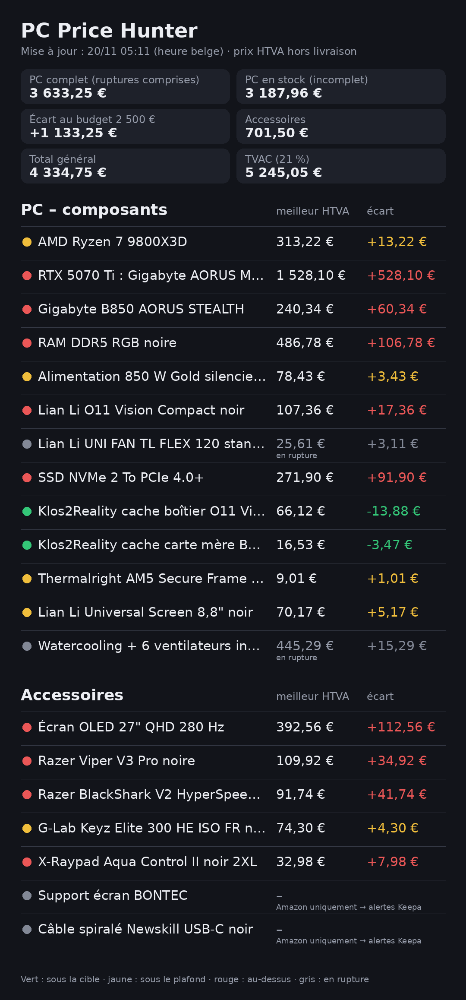

# PC Price Hunter – état actuel

**Dernière actualisation réussie : 21/11 15:41** (heure belge) · dernière exécution : 21/11 15:41

| | HTVA | TVAC (21 %) |
|---|---|---|
| **PC** ⚠️ incomplet | **3 113,58 €** | 3 767,43 € |
| Écart au budget 2 400 € / 2 500 € | 713,58 € / 613,58 € | |
| Accessoires ⚠️ incomplet | 699,02 € | 845,81 € |
| Total général | 3 812,60 € | 4 613,25 € |
| **PC – tous articles** (ruptures comprises) | **3 558,87 €** | 4 306,23 € |
| Accessoires – tous articles | 699,02 € | 845,81 € |
| Total général – tous articles | 4 257,89 € | 5 152,05 € |

_Totaux hors frais de livraison. Les premières lignes ne comptent que les offres en stock ; « tous articles » ajoute le dernier prix connu des articles en rupture, à titre indicatif (les alertes budget ne se basent que sur des offres disponibles)._
_Sans offre disponible actuellement : Watercooling 360TL + 2 packs de 3 ventilateurs inversés, Support écran BONTEC (VESA 75/100), Câble spiralé Newskill USB-C noir._
_Sans aucun prix connu (non compris même dans « tous articles ») : Support écran BONTEC (VESA 75/100), Câble spiralé Newskill USB-C noir._

## PC – composants

| Composant | Meilleur prix HTVA | Cible / plafond | Écart | Score | Où | Fraîcheur |
|---|---|---|---|---|---|---|
| 🟡 AMD Ryzen 7 9800X3D | **313,22 €** | 300 € / 320 € | 13,22 € (+4,4 %) | 49 | [Alternate (BE)](https://fr.alternate.be/AMD/Ryzen-7-9800X3D-4-7-GHz-5-2-GHz-Turbo-Boost-socket-AM5-processeur/html/product/100093605) | vérifié 21/11 15:41 |
| 🔴 RTX 5070 Ti : Gigabyte AORUS MASTER ou ASUS TUF OC | **1 453,72 €** | 1 000 € / 1 100 € | 453,72 € (+45,4 %) | 46 | [Coolblue (BE)](https://www.coolblue.be/fr/produit/959846/asus-tuf-gaming-geforce-rtx-5070-ti-oc-16-go.html) | vérifié 21/11 15:41 |
| 🔴 Gigabyte B850 AORUS STEALTH | **240,34 €** | 180 € / 220 € | 60,34 € (+33,5 %) | 37 | [Alternate (DE)](https://www.alternate.de/GIGABYTE/B850-AORUS-STEALTH-Mainboard/html/product/100175457) | vérifié 21/11 15:41 |
| 🔴 RAM DDR5 RGB noire (Kingston FURY RGB ou Corsair Vengeance RGB) | **486,78 €** | 380 € / 400 € | 106,78 € (+28,1 %) | 31 | [Alternate (BE)](https://fr.alternate.be/Corsair/Vengeance-RGB-32-Go-DDR5-6000-2x-16-Go-m%C3%A9moire-vive/html/product/100020860) | vérifié 21/11 15:41 |
| 🟡 Alimentation 850 W Gold silencieuse (liste) | **78,43 €** | 75 € / 85 € | 3,43 € (+4,6 %) | 50 | [Alternate (BE)](https://fr.alternate.be/Corsair/RM850e-2024-alimentation-modulaire-850-watt/html/product/100098365) | vérifié 21/11 15:41 |
| 🔴 Lian Li O11 Vision Compact noir | **107,36 €** | 90 € / 95 € | 17,36 € (+19,3 %) | 38 | [Alternate (BE)](https://fr.alternate.be/Lian-Li/O11-Vision-Compact-bo%C3%AEtier-midi-tower/html/product/1931123) | vérifié 21/11 15:41 |
| 🟡 Lian Li HydroShift II OLED 360TL noir (3 ventilateurs) | **280,17 €** | 280 € / 300 € | 0,17 € (+0,1 %) | 57 | [Alternate (BE)](https://fr.alternate.be/Lian-Li/HydroShift-II-OLED-Curved-360TL-Watercooling/html/product/100195858) | vérifié 21/11 15:41 |
| ⚪ Lian Li UNI FAN TL FLEX 120 pales inversées, pack de 3 noir | 82,56 € (rupture) | 75 € / 80 € | 7,56 € | | [Alternate (BE)](https://fr.alternate.be/Lian-Li/UNI-FAN-TL-FLEX-ventilateurs-de-bo%C3%AEtier-RGB/html/product/100201815) | en rupture 21/11 15:41 |
| ⚪ Lian Li UNI FAN TL FLEX 120 standard, à l'unité noir (réserve, hors total) | 25,61 € (rupture) | 22,50 € / 25 € | 3,11 € | | [Alternate (BE)](https://fr.alternate.be/Lian-Li/UNI-FAN-TL-FLEX-ventilateur-de-bo%C3%AEtier-RGB/html/product/100201754) | en rupture 21/11 15:41 |
| 🔴 SSD NVMe 2 To PCIe 4.0+ (liste provisoire) | **271,90 €** | 180 € / 200 € | 91,90 € (+51,1 %) | 38 | [Alternate (BE)](https://fr.alternate.be/Samsung/990-EVO-PLUS-2-To-SSD/html/product/100080170) | vérifié 21/11 15:11 |
| 🟢 Klos2Reality cache boîtier O11 Vision Compact | **66,12 €** | 80 € / 80 € | -13,88 € (-17,3 %) | 78 | [Klos2Reality](https://klos2reality.com/products/lian-li-o11-vision-grommet-shroud) | vérifié 21/11 15:41 |
| 🟢 Klos2Reality cache carte mère B850 Stealth | **16,53 €** | 20 € / 20 € | -3,47 € (-17,3 %) | 78 | [Klos2Reality](https://klos2reality.com/products/gigabyte-motherboard-b850-x870-stealth-ice-cover) | vérifié 21/11 15:41 |
| 🟡 Thermalright AM5 Secure Frame noir | **9,01 €** | 8 € / 10 € | 1,01 € (+12,6 %) | 38 | [LDLC (BE)](https://www.ldlc.com/fr-be/fiche/PB00581807.html) | vérifié 21/11 15:41 |
| 🟡 Lian Li Universal Screen 8,8" noir | **70,17 €** | 65 € / 75 € | 5,17 € (+8,0 %) | 42 | [Alternate (BE)](https://fr.alternate.be/Lian-Li/8-8-inch-Universal-Screen/html/product/100151196) | vérifié 21/11 15:11 |

**Watercooling 360TL + 2 packs de 3 ventilateurs inversés** : rien de complet en stock ; ruptures comprises, scénario le moins cher = 360TL (3 ventilateurs standard fournis : 2 à l'arrière, 1 en réserve) + 2 packs de 3 inversés (radiateur + bas) → 445,29 € HTVA (cible 430 €, plafond 460 €)

## Accessoires

| Composant | Meilleur prix HTVA | Cible / plafond | Écart | Score | Où | Fraîcheur |
|---|---|---|---|---|---|---|
| 🔴 Écran OLED 27" QHD 280 Hz (référence GOB2701QSC-B1) | **392,56 €** | 280 € / 300 € | 112,56 € (+40,2 %) | 38 | [Alternate (BE)](https://fr.alternate.be/iiyama/G-Master-Titan-Falcon-GOB2701QSC-B1-27-inch-Moniteur-gaming/html/product/1949539) | vérifié 21/11 15:11 |
| 🔴 Razer Viper V3 Pro noire | **109,92 €** | 75 € / 75 € | 34,92 € (+46,6 %) | 22 | [Coolblue (BE)](https://www.coolblue.be/fr/produit/953160/razer-viper-v3-pro-souris-gamer-sans-fil-noir.html) | vérifié 21/11 15:11 |
| 🔴 Razer BlackShark V2 HyperSpeed noir | **89,26 €** | 50 € / 55 € | 39,26 € (+78,5 %) | 29 | [Coolblue (BE)](https://www.coolblue.be/fr/produit/949887/razer-blackshark-v2-hyperspeed-noir.html) | vérifié 21/11 15:11 |
| 🟡 G-Lab Keyz Elite 300 HE ISO FR noir | **74,30 €** | 70 € / 75 € | 4,30 € (+6,1 %) | 45 | [Maxesport](https://maxesport.gg/fr/products/the-g-lab-keyz-elite-300-he-iso-fr-noir) | vérifié 21/11 15:11 |
| 🔴 X-Raypad Aqua Control II noir 2XL | **32,98 €** | 25 € / 30 € | 7,98 € (+31,9 %) | 38 | [Maxesport](https://maxesport.gg/fr/products/x-raypad-aqua-control-ii-noir-2xl) | vérifié 21/11 15:11 |
| Support écran BONTEC (VESA 75/100) | – | 25 € / 30 € | | | Amazon uniquement → alertes Keepa | aucun prix |
| Câble spiralé Newskill USB-C noir | – | 10 € / 15 € | | | Amazon uniquement → alertes Keepa | aucun prix |

## Sources (dernière exécution)

| Marchand | Résultats |
|---|---|
| Alternate (BE) | ok : 14, rupture : 4 |
| Alternate (DE) | ok : 1, rupture : 2 |
| Alternate (FR) | ok : 1 |
| Caseking (DE) | rupture : 2 |
| Coolblue (BE) | ok : 1, rupture : 2 |
| Grosbill | ok : 1, rupture : 1 |
| Klos2Reality | ok : 2 |
| Komparzon (test Amazon) | bloque : 1 |
| LDLC (BE) | non_conforme : 1, ok : 5 |
| Megekko (NL) | sans_prix : 1 |

---
🟢 sous la cible · 🟡 entre cible et plafond · 🔴 au-dessus du plafond · ⚪ en rupture (dernier prix connu) · score* = historique encore insuffisant (score basé sur la cible seulement).
Le score d'opportunité est un indicateur relatif (0–100), pas une probabilité. « vérifié » = lu lors de la dernière vérification ; « ancien » = dernier prix connu (moins de 24 h), source momentanément inaccessible. Aucun prix n'est inventé.
